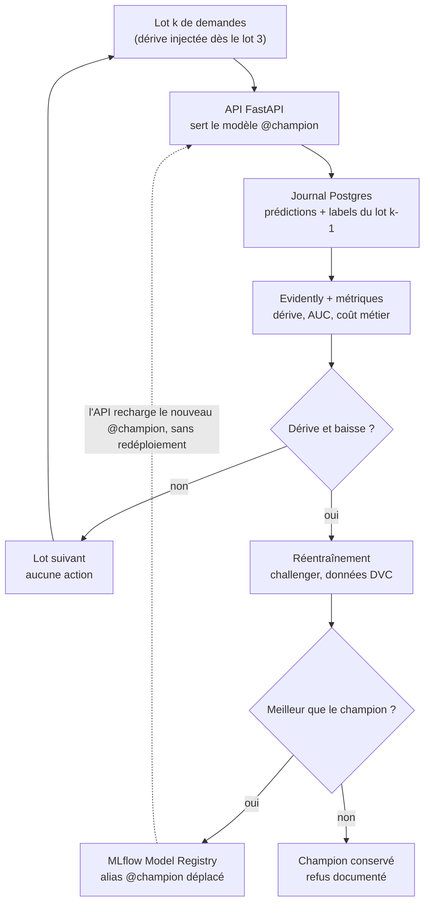

# Projet 15 — Fiche de cadrage : boucle MLOps fermée

> 12/10/2026 · Lamine CAMARA · validé par le mentor le 24/11/2026

## Contexte et besoin

Le projet ferme la boucle MLOps du modèle de scoring crédit de **Prêt à Dépenser**. Aujourd'hui, la dérive est détectée. Demain, elle déclenchera un réentraînement contrôlé.

Le modèle a été construit au **Projet 6**, puis déployé et monitoré au **Projet 8** (API FastAPI, journalisation Postgres, Evidently, dashboard). Le besoin métier est double :

- garder un modèle fiable dans le temps, sans intervention manuelle à chaque dérive ;
- pouvoir justifier chaque changement de modèle auprès du métier.

Thèmes du Projet 15 couverts :

- le cycle de vie des modèles ;
- le réentraînement automatique ;
- le suivi de la dérive ;
- le versionnage des données et des modèles (DVC, MLflow Model Registry).

## Audit de l'existant (Projet 8)

La chaîne du P8 fonctionne de bout en bout, mais elle s'arrête à l'alerte. Les limites ci-dessous viennent du rapport de drift du P8 (`Projet8/docs/etape3_rapport_drift.md`, §4 et §5) et de la fiche de tâches du P6 (Model Registry jamais finalisé).

| Limite constatée | Conséquence | Réponse du Projet 15 |
| --- | --- | --- |
| La dérive est détectée mais aucune action ne suit | Le modèle se dégrade sans réaction | Règle de décision, puis réentraînement automatique |
| Pas de labels réels en production | On surveille un proxy, pas la performance | Labels simulés avec un lot de retard : AUC et coût métier mesurés |
| Référence de dérive de 100 lignes, jamais rafraîchie | Détection peu fiable | Référence large, versionnée avec DVC, rafraîchie à chaque promotion |
| Modèle servi depuis un fichier `.joblib` | Pas d'historique ni de retour arrière | MLflow Model Registry, alias `@champion` |
| Contrôles lancés à la main | Dépend d'une personne | Pipeline rejouable lot par lot |

## Solution proposée

Chaque lot traverse la même boucle. Le nouveau modèle n'est promu que s'il fait mieux que le modèle en place.

La stack réunit MLflow (suivi et Model Registry avec alias), DVC, Evidently, FastAPI, PostgreSQL, Streamlit, Docker Compose et GitHub Actions. Seul DVC est nouveau, avec environ 2 h de prise en main. Environ 60 à 70 % du code vient du P8.

## Périmètre

Le périmètre est volontairement réduit pour tenir en 3 semaines. Chaque simplification est un arbitrage assumé entre délai et valeur.

| Inclus | Exclu (et pourquoi) |
| --- | --- |
| `application_train.csv` seul, 21 features : 17 colonnes brutes encodées et 4 ratios métier du P6 (les 13 top features du P8 issues des tables jointes ne sont pas disponibles, voir la fiche de suivi) | Les 804 features et les 3,5 Go de jointures du P6 : le réentraînement serait trop lent |
| LightGBM et seuil métier (FN = 10 × FP) repris du P6 | Recherche de nouveaux algorithmes |
| Temps simulé : une référence puis 6 à 8 lots « hebdomadaires », avec une dérive progressive injectée dès le lot 3 | Vrai trafic de production |
| Stack locale avec `docker compose` (MLflow, API, Postgres, dashboard) ; la mise en ligne se fait par paliers (voir ci-dessous) | Machine virtuelle cloud dédiée : trop de configuration (réseau, HTTPS) pour le délai |
| Pipeline Python lancé en ligne de commande, lot par lot | Orchestration Airflow, déjà démontrée au P12 (citée comme cible en production) |
| Tests pytest et CI GitHub Actions (lint et tests) | Tests de charge |

### Paliers de livraison

Le projet avance par paliers. À chaque palier, le projet est présentable. Toutes les adresses passent par la configuration (`MLFLOW_TRACKING_URI`, `DATABASE_URL`) : passer d'un palier à l'autre ne demande que de la configuration, pas de réécriture du code.

| Palier | Contenu | Charge | Statut |
| --- | --- | --- | --- |
| 1 — Local | Boucle complète avec `docker compose`, démonstration en direct en soutenance et vidéo | inclus dans les 60 h | Obligatoire |
| 2 — Vitrine en ligne | Space Hugging Face (Streamlit) qui rejoue le scénario à partir des résultats exportés : versions, performance par lot, dérive, décisions. API servant le `@champion` final en option. Uniquement des métriques agrégées et le modèle, sans données brutes. | + 4 à 5 h | Conseillé |
| 3 — Boucle en ligne | MLflow et stockage DVC sur DagsHub, journal sur Neon, API et dashboard sur Hugging Face, boucle lancée par GitHub Actions | + 6 à 8 h | Seulement s'il reste du temps |

Les données Home Credit viennent d'une compétition Kaggle, dont le règlement limite la redistribution. Elles restent donc privées à tous les paliers. Les conditions de l'offre gratuite de DagsHub (dépôts privés, quotas) sont à vérifier avant le palier 3.

## Règles de décision et critères de succès

Les seuils exacts seront calibrés au lot 1.

- **Déclenchement du réentraînement** : la dérive du score prédit est significative (p < 0,05) **et** l'AUC baisse ou le coût métier augmente au-delà d'un seuil à calibrer.
- **Promotion du challenger** : son coût métier est plus bas et son AUC n'est pas dégradée, sur le même jeu de test que le champion.
- **Retour arrière** : on déplace l'alias `@champion` vers la version précédente, sans redéployer l'API.

Le projet est réussi si :

- [ ] Sur le scénario simulé, la dérive est détectée et déclenche au moins un réentraînement.
- [ ] Le modèle promu récupère une partie de la performance perdue (gain mesuré et affiché au dashboard).
- [ ] Chaque version du modèle est traçable : les données avec DVC, les paramètres et les métriques avec MLflow.
- [ ] Le cycle complet se rejoue de zéro avec une seule commande.
- [ ] Les tests passent en CI.

## Planning, coûts et risques

La charge du palier 1 est estimée à environ 60 h sur 3 semaines, dont 33 h pour la partie technique. Le palier 2 ajoute 4 à 5 h, le palier 3 encore 6 à 8 h. Le coût d'infrastructure reste nul à tous les paliers, grâce aux offres gratuites.

| Semaine | Bloc | Charge |
| --- | --- | --- |
| 1 | Cadrage, besoins, audit du P8 | 5 h |
| 1 | Données, lots simulés, DVC | 6 h |
| 1 | Registre MLflow et API qui charge `@champion` | 6 h |
| 2 | Pipeline : dérive, performance, réentraînement, promotion | 10 h |
| 2 | Dashboard, tests, README | 6 h |
| 2 | Palier 2 : vitrine Hugging Face (conseillé) | + 4 à 5 h |
| 2 | Rapport de conduite de projet | 8 h |
| 3 | Carte mentale | 4 h |
| 3 | Portfolio | 10 h |
| 3 | Préparation de la soutenance | 5 h |
| 3 | Palier 3 : boucle en ligne (s'il reste du temps) | + 6 à 8 h |

| Risque | Parade |
| --- | --- |
| Le réentraînement est trop lent | Limiter les features et la taille des lots |
| La dérive simulée est trop faible pour être détectée | Calibrer l'amplitude sur les lots 1 et 2 |
| Le challenger ne bat jamais le champion | Garder ce résultat : le refus de promotion est aussi une décision documentée |
| La mise en ligne prend plus de temps que prévu | S'arrêter au palier atteint : le palier 1 suffit à la validation |
| Le mentor refuse une extension d'un projet passé | Repli : même pipeline sur le dataset Bike Sharing (UCI), qui a une dérive saisonnière naturelle |

## À valider avec le mentor

- [x] Une extension des Projets 6 et 8 est-elle acceptée comme projet personnel, ou faut-il le repli Bike Sharing ? → **Validé par le mentor le 24/11/2026 (option A)**
- [ ] Le palier 1 (local + vidéo) suffit-il, ou une démo en ligne est-elle attendue (palier 2 ou 3) ?
- [x] Quel support pour le portfolio : GitHub Pages ou PDF ? → **GitHub Pages**
- [ ] Quel format est attendu pour le rapport de conduite de projet ?
