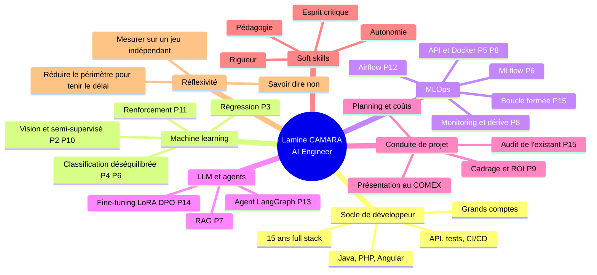

# Carte mentale

!!! warning "Version de travail"
    Cette carte doit être validée par le mentor avant la soutenance.

## Niveaux

Les niveaux de chaque compétence sont détaillés dans la page [Compétences](competences.md).
