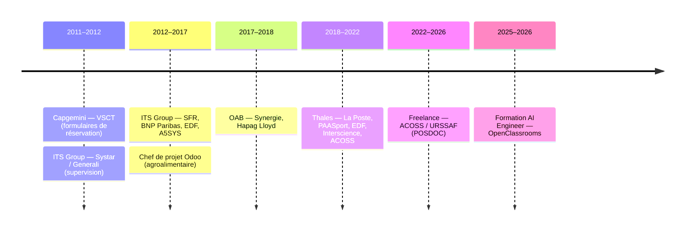

# Parcours

## Profil

Développeur full stack depuis 15 ans (Java/Spring Boot, PHP/Symfony, Angular), principalement en
mission pour de grands comptes. En 2025, j'ai commencé la formation **AI Engineer**
d'OpenClassrooms pour ajouter à ce socle le machine learning, le MLOps et les systèmes à base de
LLM.

Ce que j'apporte d'un projet d'IA :

- **le réflexe production** : une API testée, conteneurisée, déployée par CI/CD, surveillée ;
- **la maintenance dans la durée** : TMA, montées de version (Angular 8 → 19, Symfony 2.6 → 3.4),
  migration SVN → Git ;
- **le dialogue avec le métier** : spécifications, estimation de charges, recette, formation des
  utilisateurs.

## Formation

| Année | Diplôme | Établissement |
|---|---|---|
| 2025–2026 | Formation AI Engineer (15 projets) | OpenClassrooms |
| 2008 | Master Génie électrique et informatique industrielle | Université de Rouen |
| 2006 | Licence Électronique, électrotechnique, automatique | Université de Rouen |

## Expérience professionnelle

### Missions récentes

**Développeur full stack Java / Angular — freelance chez ACOSS/URSSAF** · depuis 2023
:   POSDOC, portail de production et de distribution de documents. Nouvelles fonctionnalités et
    TMA, génération automatique de bilans PDF, permissions par rôle, intégrations GraphQL,
    tests Jasmine/Karma et Playwright, migration vers Angular 19.
    Java 11Spring BootAngular 19GraphQLPlaywright

**Développeur full stack PHP / Angular — Thales puis freelance, chez ACOSS** · 2021–2023
:   Portail technique et ses modules (équipe de 5). Montées de version Symfony 2.6 → 3.4 et
    Angular 8 → 14, migration SVN → Git, packaging et déploiement.
    SymfonyAngularGit

**Développeur web — Thales, chez Interscience, EDF et La Poste** · 2018–2021
:   Station de comptage de colonies (sécurisation d'API, signature des résultats), SSO SAML v2
    chez EDF, refonte de web services REST et des logs à La Poste.
    PHPLaravelVueJSDocker

**Développeur full stack Java / Angular — Thales, centre de service** · 2019–2020
:   PAASport, portail en micro-services (SSO, notifications, GED), équipe de 14.
    Spring BootAngularmicro-services

**Chef de projet OpenERP (Odoo) — ITS Group** · 2014
:   Recueil des besoins, spécifications, planning, développement de modules, mise en production
    et formation des utilisateurs (équipe de 6).
    PythonOdooPostgreSQL

??? note "Missions antérieures (2011–2017)"

    - **Synergie, Hapag Lloyd** (OAB, 2017) : espace candidat Drupal 8, portail de centres d'appel.
    - **A5SYS, EDF** (ITS Group, 2015–2017) : applications Symfony (gestion immobilière, contrôle
      d'accès réseau), estimation de charges, documentation.
    - **Sites ITS Group** (2015) : refonte responsive de six sites Drupal 7.
    - **BNP Paribas, SFR** (ITS Group, 2012–2014) : prise de rendez-vous, génération d'étiquettes.
    - **Systar / Generali** (ITS Group, 2012) : supervision applicative (Java, JSP).
    - **VSCT** (Capgemini, 2011) : formulaires de réservation, tests sous Quality Center.

## Langues

Anglais.
