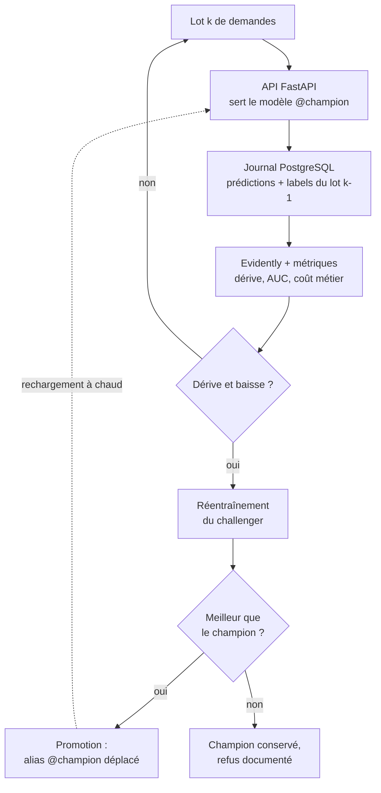

# Projet personnel : boucle MLOps fermée

!!! info "Projet en cours"
    Le cadrage est validé. Cette page sera complétée avec les résultats du scénario
    (dérive détectée, réentraînements, promotions) et la vidéo de démonstration.

## Le besoin

Au [Projet 8](projets.md#p8), le modèle de scoring crédit de **Prêt à Dépenser** est en
production et sa dérive est surveillée. Mais la chaîne s'arrête à l'alerte : personne ne réagit
automatiquement, et le modèle se dégrade.

Le métier attend deux choses :

- garder un modèle fiable dans le temps, sans intervention manuelle à chaque dérive ;
- pouvoir **justifier chaque changement de modèle**.

## Audit de l'existant

| Limite constatée au P8 | Réponse de ce projet |
|---|---|
| La dérive est détectée, aucune action ne suit | Règle de décision, puis réentraînement automatique |
| Pas de labels réels : on surveille un proxy | Labels simulés avec un lot de retard : AUC et coût métier mesurés |
| Référence de dérive de 100 lignes, jamais rafraîchie | Référence large, versionnée avec DVC, rafraîchie à chaque promotion |
| Modèle servi depuis un fichier `.joblib` | MLflow Model Registry, alias `@champion`, retour arrière possible |
| Contrôles lancés à la main | Pipeline rejouable lot par lot, en une commande |

## La solution

**Règles de décision**

- *Réentraîner* si la dérive du score prédit est significative **et** si l'AUC baisse ou si le
  coût métier augmente.
- *Promouvoir* le challenger si son coût métier est plus bas et son AUC n'est pas dégradée, sur
  le même jeu de test.
- *Revenir en arrière* en déplaçant l'alias `@champion`, sans redéployer l'API.

MLflow Model RegistryDVCEvidentlyFastAPIPostgreSQLStreamlitDocker ComposeGitHub Actions

## Critères de succès

- [ ] La dérive simulée est détectée et déclenche au moins un réentraînement.
- [ ] Le modèle promu récupère une partie de la performance perdue.
- [ ] Chaque version est traçable : données (DVC), paramètres et métriques (MLflow).
- [ ] Le scénario complet se rejoue de zéro en une seule commande.
- [ ] Les tests passent en CI.

[:fontawesome-brands-github: Code](https://github.com/Formation-AI-Engineer/realisez-le-portfolio-d-AI-engineer){ .md-button .md-button--primary }
